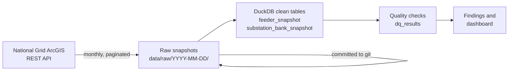

# Grid Headroom Tracker

**Live dashboard:** https://saloniramanuj6.github.io/grid-headroom-tracker/

A monthly data pipeline that saves a snapshot of National Grid's Massachusetts hosting capacity data, so changes in feeder headroom can be tracked over time.

## The problem

National Grid publishes a public [Massachusetts System Data Portal](https://systemdataportal.nationalgrid.com/MA/) showing how much more distributed generation (solar, wind, storage) each distribution feeder can accept. This is called hosting capacity.

The portal shows the current state only. Each refresh replaces the previous numbers, so someone outside National Grid can't answer questions like:

- Which feeders are filling up fastest?
- How much did the waiting line of pending projects grow since last quarter?
- When was this data last actually updated?

This project keeps the history that the portal doesn't.

## What it does



| Step | Script | What it does |
|---|---|---|
| Profile | `step1_peek.py` | Inspects each API layer: row counts, field names, sample rows |
| Extract | `step2_extract.py` | Pulls every row with stable paging, saves an untouched dated snapshot |
| Load | `step3_clean.py` | Builds clean tables in DuckDB: standardizes nulls, removes duplicates, adds derived metrics. Safe to rerun. |
| Check | `step4_quality.py` | Runs data quality checks with FAIL / WARN / INFO levels and stores the results |
| Schedule | `.github/workflows/monthly-snapshot.yml` | Runs everything on the 2nd of each month on GitHub Actions |

### Design choices

- **Raw first, never edited.** Each run saves exactly what the API returned before any cleaning. If cleaning logic changes, every past month can be rebuilt.
- **Raw snapshots live in git; the database doesn't.** The DuckDB file is rebuilt from the snapshots on every run, so the snapshots are the single source of truth.
- **Raw is saved before checks run.** A failed quality check never loses that month's data.
- **Two dates per row.** `snapshot_date` is when the pipeline captured the data. `source_updated_date` is the date National Grid stamps on it. The gap between them measures freshness.
- **Idempotent loads.** Loading the same day twice replaces that day instead of duplicating it.

## What profiling the source revealed

| Finding | How it's handled |
|---|---|
| `Master_CDF` is unique and never empty across all 967 feeders | Used as the feeder primary key |
| The substation layer has 967 rows but only 416 distinct ones (57% repeated), and no feeder key | Deduplicated into its own table |
| Text value "Data Unavailable" used in place of empty | Converted to real NULLs |
| Every row's `Updated_Date` is Feb 6, 2026, 280 days before the first snapshot | Flagged by a freshness check (WARN) |
| 235 feeders total exactly 10.0 MW of capacity | Open question: likely a methodology cap |

## First snapshot findings (Nov 13, 2026)

Out of 967 three-phase feeders:

- 213 feeders (22%) are 90% or more full, counting connected and pending projects
- 170 feeders (18%) are oversubscribed: more pending MW is waiting than the feeder has room for
- Several substations show 0.0 MW left across every feeder, including Northoxford2, Whitinspond320, Barre604, Chestnuthill702 and Foreststreet2
- Winthrop22 has 7 of 8 feeders nearly full but 9.77 MW left in total, so most of its remaining room sits on a single feeder

`pct_full` is a derived metric, not a National Grid field:

```
feeder_limit_mw = available_mw + connected_mw
pct_full        = (connected_mw + pending_mw) / feeder_limit_mw
```

## What this data does and doesn't show

- It covers hosting capacity for generation (solar, wind, storage). It is not load capacity, so it doesn't show room for large new electricity users such as data centers.
- Totals exclude battery storage (BESS), following the source fields.
- It covers Massachusetts three-phase feeders only. National Grid's New York portal is a natural next source.
- The numbers are only as current as the source. With the source date at Feb 2026, findings reflect that analysis, not today's grid.
- This is an independent project using public data. It isn't affiliated with National Grid.

## Run it yourself

```
pip install -r requirements.txt
python step2_extract.py
python step3_clean.py
python step4_quality.py
```

Requires Python 3.10+. The database is created at `data/grid.duckdb`.

## Roadmap

- [ ] Month-over-month change table: which feeders lost the most headroom
- [ ] Dashboard of feeder and substation headroom
- [ ] Add National Grid's New York System Data Portal
- [ ] Alert when the source date changes, meaning a new analysis was published

---

Built by [Saloni Ramanuj](https://linkedin.com/in/saloni-ramanuj-362329235), MS Information Technology (Data Management), Arizona State University.
