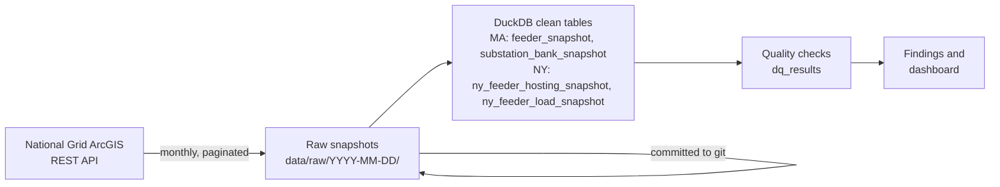

# Grid Headroom Tracker

**Live dashboard:** https://saloniramanuj6.github.io/grid-headroom-tracker/ (Massachusetts) · [New York tab](https://saloniramanuj6.github.io/grid-headroom-tracker/#NY)

A monthly data pipeline that saves snapshots of National Grid's public grid capacity data for Massachusetts and New York, so changes in feeder headroom can be tracked over time.

## The problem

National Grid publishes public System Data Portals for [Massachusetts](https://systemdataportal.nationalgrid.com/MA/) and [New York](https://systemdataportal.nationalgrid.com/NY/). They show how much more distributed generation (solar, wind, storage) each distribution feeder can accept, called hosting capacity. New York also publishes load capacity: how much new demand, such as EV chargers and heat pumps, each feeder can serve.

Each portal shows the current state only. Each refresh replaces the previous numbers, so someone outside National Grid can't answer questions like:

- Which feeders are filling up fastest?
- How much did the waiting line of pending projects grow since last quarter?
- When was this data last actually updated?

This project keeps the history that the portal doesn't.

## What it does



| Step | Script | What it does |
|---|---|---|
| Profile | `profile_source.py` | Inspects each API layer: row counts, field names, sample rows |
| Extract | `extract.py` | Pulls every row from both states with stable paging and saves an untouched dated snapshot. New York sources are listed in a config dictionary, so adding a source is one new entry. |
| Load | `load.py` | Builds clean tables in DuckDB for both states: standardizes nulls, removes duplicates, adds derived metrics. Safe to rerun. Skips New York for older snapshots that don't include it. |
| Check | `quality_checks.py` | Runs data quality checks with FAIL / WARN / INFO levels and stores the results |
| Publish | `build_dashboard.py` | Builds the dashboard page in `docs/` with a Massachusetts / New York switch, served by GitHub Pages |
| Schedule | `.github/workflows/monthly-snapshot.yml` | Runs everything on the 2nd of each month on GitHub Actions |

### Design choices

- **Raw first, never edited.** Each run saves exactly what the API returned before any cleaning. If cleaning logic changes, every past month can be rebuilt.
- **Raw snapshots live in git; the database doesn't.** The DuckDB file is rebuilt from the snapshots on every run, so the snapshots are the single source of truth.
- **Raw is saved before checks run.** A failed quality check never loses that month's data.
- **Capture date and source date kept separately.** `snapshot_date` is when the pipeline captured the data; the source's own dates are kept alongside it. The gap measures freshness. New York keeps two source dates (capacity analysis and project data), and both are preserved.
- **Idempotent loads.** Loading the same day twice replaces that day instead of duplicating it.

## What profiling the source revealed

### Massachusetts

| Finding | How it's handled |
|---|---|
| `Master_CDF` is unique and never empty across all 967 feeders | Used as the feeder primary key |
| The substation layer has 967 rows but only 416 distinct ones (57% repeated), and no feeder key | Deduplicated into its own table |
| Text value "Data Unavailable" used in place of empty | Converted to real NULLs |
| Every row's `Updated_Date` is Feb 6, 2026, 280 days before the first snapshot | Flagged by a freshness check (WARN) |
| 235 feeders total exactly 10.0 MW of capacity | Open question: likely a methodology cap |

### New York

| Finding | How it's handled |
|---|---|
| Two separate dates: `hca_refresh_date` (capacity analysis, Mar 31, 2026 for most feeders, 14 re-run Sep 30) and `feeder_dg_refresh_date` (project data, Oct 2, 2026) | Both stored; freshness check uses the project data date |
| `Master_CDF` unique across 1,913 hosting feeders and 1,909 load feeders; 1,871 appear in both | Joined on feeder ID to show solar room and load room side by side |
| Empty `notes` stored as blank text | Converted to real NULLs |
| 7 feeders report negative MW "connected since refresh" | Flagged by a WARN check; open question for the source team |
| The substation layer repeats bank data once per feeder | Kept in raw snapshots; dashboard aggregates banks from feeder rows |

## First snapshot findings (Nov 13, 2026)

### Massachusetts

Out of 967 three-phase feeders:

- 213 feeders (22%) are 90% or more full, counting connected and pending projects
- 170 feeders (18%) are oversubscribed: more pending MW is waiting than the feeder has room for
- Several substations show 0.0 MW left across every feeder, including Northoxford2, Whitinspond320, Barre604, Chestnuthill702 and Foreststreet2
- Winthrop22 has 7 of 8 feeders nearly full but 9.77 MW left in total, so most of its remaining room sits on a single feeder

`pct_full` is a derived metric, not a National Grid field:

```
feeder_limit_mw = available_mw + connected_mw
pct_full        = (connected_mw + pending_mw) / feeder_limit_mw
```

### New York

Out of 1,913 feeders:

- 320 feeders (17%) have no room for new solar, even at the best location on the feeder
- 480 feeders (25%) have more solar waiting in the queue than their maximum hosting capacity
- 63 feeders carry a utility note that they are closed to projects over 50 kW until a capital investment project is completed, with estimated dates from 2029 to 2032
- On the demand side, 21 feeders peak above their rating, and 148 have under 0.5 MW of room for new load

`pct_of_rating_used` is a derived metric:

```
pct_of_rating_used = feeder_peak_load / min(feeder_rating, substation_bank_rating)
```

## What this data does and doesn't show

- Massachusetts data covers hosting capacity for generation only. New York adds load capacity at the feeder level, but neither covers transmission-level connections for very large users such as data centers.
- Massachusetts totals exclude battery storage (BESS), following the source fields.
- New York's load capacity layer has no date field, so its freshness can't be measured from the data.
- The numbers are only as current as the source. Massachusetts findings reflect a Feb 2026 analysis; New York project data is from Oct 2026.
- This is an independent project using public data. It isn't affiliated with National Grid.

## Run it yourself

```
pip install -r requirements.txt
python extract.py
python load.py
python quality_checks.py
python build_dashboard.py
```

Requires Python 3.10+. The database is created at `data/grid.duckdb`.

## Roadmap

- [x] Dashboard of feeder and substation headroom
- [x] Add National Grid's New York System Data Portal (hosting and load capacity)
- [ ] Month-over-month change table: which feeders lost the most headroom
- [ ] Alert when a source date changes, meaning a new analysis was published

---

Built by [Saloni Ramanuj](https://linkedin.com/in/saloni-ramanuj-362329235), MS Information Technology (Data Management), Arizona State University.
